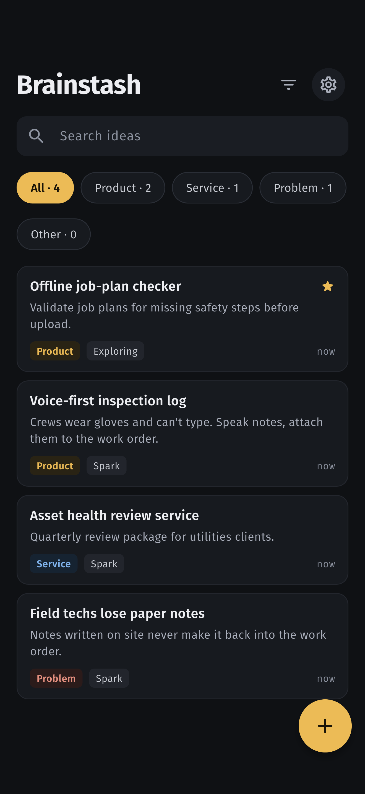
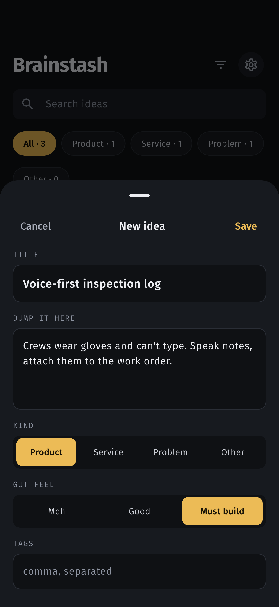
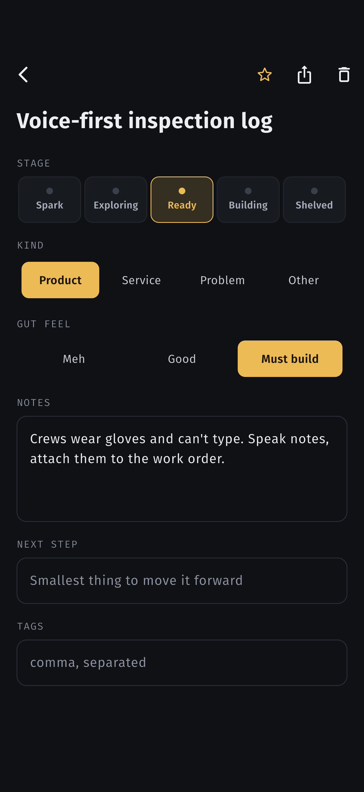
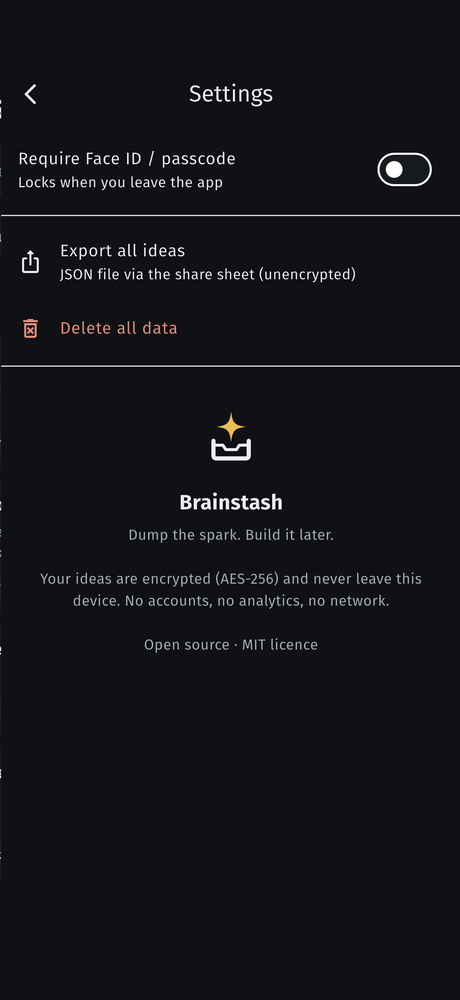

<p align="center"></p>

<h1 align="center">Brainstash</h1>
<p align="center"><b>Dump the spark. Build it later.</b><br>
A private, offline iOS inbox for product ideas, service ideas, problems worth solving — anything.</p>

---

## Why

Ideas show up at bad times: in the shower, on a site visit, at 2 am. Brainstash makes
capture take seconds (only a title is required), then lets you review, triage and move ideas
through stages until one is ready to become a project.

## Features

- **Two-tap capture** — tap **+**, type a title, save. Notes, kind, gut feel and tags are optional.
- **Voice capture** — tap the mic and just talk. Recognition runs **on-device**; the first sentence becomes the title.
- **Kinds** — Product · Service · Problem · Other, with filter chips and counts.
- **Stages** — Spark → Exploring → Ready → Building → Shelved.
- **Search** across titles, notes, next steps and `#tags`.
- **Star** the ones that matter; starred float to the top.
- **Next step** field so every idea has a smallest move forward.
- **Share** a single idea as text, or **export everything** as JSON.
- **Face ID / passcode lock** (optional) and app-switcher privacy cover.

## Privacy & security

- Ideas are stored **only on your device**, encrypted with **AES-256**. The key lives in the iOS
  Keychain (`first_unlock_this_device` — never synced, never in backups).
- iOS **Data Protection: Complete** on the app's files.
- Voice dictation uses Apple's on-device speech recognition only — audio never leaves the phone and is never stored.
- **No network access, no analytics, no accounts, no third-party SDKs that phone home.**
  Fonts are bundled.
- Automated scans on every change: gitleaks, osv-scanner, semgrep, plus MobSF on the built app.
  See [SECURITY.md](SECURITY.md) and [`security/REPORT.md`](security/REPORT.md).

## Screenshots

| Inbox | Capture | Detail | Settings |
|---|---|---|---|
|  |  |  |  |

## Build it yourself

Requirements: macOS, Xcode 26+, Flutter 3.47+, CocoaPods.

```bash
git clone https://github.com/valueztechaus/brainstash.git
cd brainstash
flutter pub get
flutter test                 # 46 unit + widget tests
open -a Simulator
flutter run                  # runs on the booted iOS simulator
# end-to-end on the simulator (real Keychain + encrypted store), saves screenshots:
flutter drive --driver=test_driver/integration_test.dart --target=integration_test/app_test.dart
```

> **Note:** `flutter drive` installs a *test* build that ignores real taps. Run `flutter run`
> afterwards to put the normal app back on the simulator.

Install on your own iPhone: open `ios/Runner.xcworkspace` in Xcode → *Signing & Capabilities* →
pick your team → change the bundle id from `com.valueztech.brainstashapp` to your own → Run.

Security checks: `./tools/security_scan.sh` and `./tools/mobsf_scan.sh <ipa>`

## Project layout

```
lib/
  models/idea.dart          domain model + validation
  data/                     encrypted Hive repository, Keychain key store
  state/idea_store.dart     ChangeNotifier: list, search, filters
  services/app_lock.dart    Face ID / passcode lock
  screens/                  inbox, capture sheet, detail, settings
  widgets/                  idea card, segmented choice, stage picker, brand mark
test/                       unit + widget tests
docs/                       spec, plan, decisions, App Store guide, token report
security/                   scan reports
tools/                      security_scan.sh, token_report.py
```

## Built with Claude Code

This app was designed (Claude Design), coded, tested, security-scanned and documented end to
end by Claude Code running Claude Opus 5.5. Every decision is in
[docs/DECISIONS.md](docs/DECISIONS.md); token usage is in [docs/TOKENS.md](docs/TOKENS.md).

## Licence

[MIT](LICENSE) © 2026 Valueztech. Fira Sans / Fira Code fonts under the SIL Open Font Licence
(`assets/fonts/OFL.txt`).
